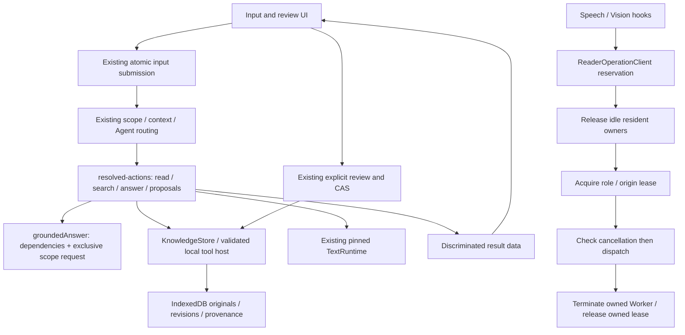

# Current application architecture

## Current-answer formatting boundary — 2026-10-27

An explicit rewrite/format request about the current answer binds that exact prior assistant turn before planner/history compaction. Quoted target phrases and mixed tool/write/file commands remain outside this shortcut. A semantic read/rewrite now inherits the selected original's existing source IDs, versions and ranges instead of dropping them when plain generation returns no sources. These references establish provenance, not semantic entailment.

The read-only text inspector can select text.format_lines with a closed checklist/bullets/numbered enum. Host code formats existing nonempty lines; the model does not compose the resulting items. The operation has no network or storage ports, caps input/output at 30,000 characters and 1,000 lines, refuses code fences, nested lists and pipe tables, and preserves checked boxes and nonsequential numbers such as years. It does not perform semantic extraction, table construction or summarization. Receipts identify the exact original turn. Reviewed ordinary-note corrections may use the same operation through the existing approval/CAS/history/Undo and backup validator; no automatic overwrite is added.

## Pending correction preflight — 2026-10-27

The edit branch checks the canonical pending-review slot before Text acquisition/proposal generation. An occupied slot refreshes the review surface and returns a host-owned needsInput outcome while preserving both the existing review and new request draft. Malformed records remain inert and block replacement until explicitly handled. Staging and approval retain their complete transactional validation for cross-tab races. Read/chat routes are unaffected; classification of unresolved intents may still need a model. See PENDING-REVIEWS.md.

## Opened-file correction commands and evidence admission — 2026-10-27

A bounded single imperative correction in English/Japanese can bind the already opened file before general planning. This selects only edit/file, not replacement bytes. Attachments, explicit dialogue references, named/other/plural file targets, compound commands and unsupported wording retain the existing routes. The exact pinned original is read before Text acquisition. Correction inference receives the original and human instruction without unrelated history; local names/places/times/numbers are requested as the smallest exact text.replace span. Whole-note reorganization/translation retains the separate rewrite path. All proposals retain full Before/After, pending-review persistence, explicit approval, CAS, history and Undo. No general multilingual intent or semantic-correctness guarantee follows from these bounded rules or a successful model sample.

Initially resolved file answers/summaries similarly defer acquisition to the existing groundedAnswer callback after canonical eligibility/source checks. Missing, withdrawn or empty files fail without load, compaction or releasing an unrelated resident. Valid sources still use the same local-only runtime/lease manager and generation/source revalidation. No new runtime, permission, storage migration or network fallback is introduced.

## Reviewed answer source selection — 2026-10-27

Save note starts from its already pinned answer. DialogueCopySource owns only optional, bounded source browsing (12 original previews per page, NFKC search); dialogue-copy.ts remains the read-only selector and commit-time original/reference validator. Internal message numbers are no longer a second mutable form field. Same-source selection preserves manual edits; choosing another source after edits uses the existing discard review. Stored original bytes, revision refs, approval and compare-and-swap contracts are unchanged. No generation occurs during selection or saving.

## Bound file questions do not prepare dialogue context — 2026-10-27

When the initial resolved answer/summary already targets a file, Send skips dialogue counting/compaction. The grounding layer validates that pinned revision and already excludes unrelated conversation for file evidence, so preparing global dialogue first served no answering purpose. It could nevertheless generate/persist an unrelated compaction. Explicit saved-Memory, attachment and original-message paths retain their existing context policy; unresolved requests still prepare history when planning needs it. File source validation, acquisition ownership, token limits, generation/citation checks, source-change refusal and reviewed Save are unchanged. Initially bound file answer/summary now validates original eligibility before acquiring the selected model through the existing manager. Unresolved planner routes still acquire a model to classify intent. No claim is made that every source-preflight latency is eliminated.

## Selected dialogue originals use native messages — 2026-10-27

After the application resolves one exact prior message for recall/rewrite, its transient context uses `selectedOriginal: {speaker, text}`. The generation boundary emits that exact text under its native user/assistant message role and the latest instruction separately. Canonical turn ID/index, speaker and original range remain in the existing read/inspection receipts; they are no longer encoded as archive JSON for this single-source generation. This avoids giving the model administrative labels to reproduce. The fixed system still treats earlier text as untrusted context and grants no tool/write/network authority; selected-original output asks for no added speaker labels unless requested. No prefix stripping or original-text rewriting is performed, so literal labels remain available for exact quotation.

General multi-turn history, archive retrieval/compaction, canonical source selection, literal split/replace tools, output budgeting/continuation, cancellation and reviewed Save retain their existing paths. The new field is transient application context, not a persisted dialogue/schema migration or a user-supplied role-control setting. Controlled tests verify native speaker roles/exact bytes, exclusion of unrelated archive metadata and retained canonical target receipts. Runtime/model output quality remains evidence-scoped.

## Retained dialogue outcome projection — 2026-10-27

`dialogueTurnStatus` is the shared UI/history projection for the fixed interrupted-request marker. A nonempty completed answer suppresses a stale marker retained by older builds, without rewriting stored turns, answers, source refs, revisions or activity. Genuine errors such as Stopped remain visible even beside answer text. Blank/missing answers remain unfinished. The UI can additionally suppress the placeholder for the exact currently executing turn; another running request must not hide historical unfinished turns. The history/model boundary uses the completed-answer rule without any active execution exemption. Input submission and completion share the marker constant; canonical note storage and dialogue schema are unchanged.

## Bounded citation protocol repair — 2026-10-27

Grounded answers can make one protocol retry for a citation mismatch when the existing single-source exact-quote recovery does not apply. The retry keeps the original question, evidence and output budget; a fixed application instruction requests verbatim quotes from the matching source labels. It does not splice guessed quotations into output or silently remove invalid citations. Sources are revalidated against current originals before retry, actual tokenizer limits and cancellation remain enforced, and the final response must pass the unchanged parser and current-revision validation. A second mismatch fails; no retry loop or automatic model change occurs. Successful repairs are identified as `recovery: citation-retry` in the existing operation receipt. Syntax repair and citation repair share one retry branch; single-source exact-quote recovery retains its prior scope. This verifies byte provenance, not general semantic entailment or model answer quality.

See [the current review and migration target](ARCHITECTURE-REVIEW.md) for remaining structural gaps.

## Retrieval-bound evidence and deferred acquisition — 2026-10-27

A question explicitly naming saved Memory, or a literal answer:/summarize: command, starts a fresh stored-source scope. Failed retrieval cannot borrow references from unrelated dialogue. When retrieval returns passages, historical excerpts may extend only the same retrieved note/revision pairs. Deictic follow-ups retain the existing validated-source path; no historical record is deleted or rewritten. Stored-knowledge generation with no eligible evidence (and no checked calculation) stops before token counting, compaction or generation. This validates evidence scope/bytes, not universal semantic relevance of search hits or model claims.

For already explicit Memory answer/summary routes, submission defers Text acquisition to groundedAnswer through a trusted acquireModel callback. Retrieval and source validation run first; only a nonempty admitted source set invokes the existing model execution manager, with its idle-owner release, lease, local-runtime verification, selected-model checks and cancellation rules. General planner routes still need a model to select an action. Source versions are checked again after generation/compaction. No network fallback, new preparation permission or knowledge write authority is introduced.

## Explicit current-answer rewrites — 2026-10-27

A bounded, single read-only rewrite that explicitly names the current assistant answer (for example, Japanese 今の回答を日本語で短くまとめて or English Summarize your last answer) binds target=current before Decision/Text planning. The canonical dialogue resolver selects the exact retained answer ID and assistant speaker, including legacy records without a persisted currentResult pointer. Missing targets fail rather than falling through to Memory. This uses the same explicit-source principle as current-file/current-attachment routing; it does not infer a target from bare it/that.

The application verifies/loads the selected local Text model when needed, without compacting unrelated history for this already bound target. Existing read-only text inspection and conversation generation perform the actual requested rewrite from the selected original. Opened-file metadata or stored-note excerpts cannot become replacement input. Original turns and knowledge remain unchanged; writes, mixed source commands and unsupported phrasing retain their existing approval/planner routes. This is a scoped routing correction, not general semantic source validation or a fixed translated answer.

## Dialogue provenance and rejected history selectors — 2026-10-27

The model-facing history projection now retains at most12 distinct source ID/
revision pairs per turn. It does not copy reference quotes, paths or arbitrary
reference fields into dialogue. Planner and reply history label these identities
as navigation/provenance metadata, never source contents. Canonical dialogue,
originals, backups and source validation contracts are unchanged. Factual
follow-ups about saved content still require the grounded answer path; provenance
metadata alone cannot authorize a citation, write, tool or network operation.

The agent coordinator may replan once per submitted turn after the fixed
validator category `history target` rejects a missing history selector. The
rejected plan executes nothing and keeps its failed receipt. A fixed host-owned
hint asks the model to re-evaluate; raw diagnostic/model output is not fed back
as an instruction and no original index or speaker is filled in by the host.
The new plan goes through the complete existing validator and scope checks.
Other planner protocol errors, runtime failures, Stop and receipt-storage failures are
terminal. Repeated history-selector rejection is terminal, and the tool-call
budget does not increase. This is bounded protocol recovery, not a guarantee of
correct semantic routing or factual answers from any model.

## User device performance samples — 2026-10-26

Developer retains one Run tests action. Test options selects Quick (default) or
Performance. Quick validates exact structured READY; Performance runs one fixed
prose-128-v1 sample with at most128 output tokens. Home Screen continuation
persists the finite test mode; unknown persisted modes are rejected, and old
markers default to Quick. The UI reports actual Load time, available TTFT,
end-to-end generation speed, token counts and runtime memory counters. It hides
old success/metrics and disables copying the previous report during a new run.

The bounded report includes workload, configured engine/backend, registered
quantization metadata, model/runtime revisions, input/output tokens and load
state. Known CPU thread/prompt/cache counters are accepted; no physical-core
or GPU-selection claim follows from configuration or prerequisites. Copying
projects only allowed metadata and never includes generated reply text.
One timing sample is not sustained performance, thermal or answer-quality proof.


## One-button device test — 2026-10-26

Settings > Developer now has one Run tests start action. The UI-independent
`device-test-suite.ts` collects a bounded baseline once. In an installed Home
Screen app it saves the report before arming the existing one-shot continuation;
selected Text generation runs only after relaunch. The selected ID is bound in
the marker and the existing claim-before-execution crash guard prevents repeats.
The user performs Airplane Mode, app close and Home Screen launch. The browser
cannot verify those OS actions; existing report warnings remain authoritative.

A browser-tab run checks the prepared selected Text model immediately, then saves
one report without arming a separate Home Screen storage context. No model files
or runtime assets are acquired by these tests; unprepared or blocked models are
not-run. The test's own loaded Text model is unloaded afterward. Model replies
are discarded, not retained in diagnostics or knowledge. One Run is the explicit
consent for the short selected-model check; the old separate generation button
and off-by-default after-restart checkbox have been removed from Developer.

The primary action becomes Cancel test while awaiting a restart. Copy report
remains a separate output action; Stop remains available during model execution.
The local report stays bounded and privacy-preserving. Existing schema-1 markers,
including legacy modelTestRequested=false, still use their original continuation
semantics. No changes to knowledge storage, model defaults or network settings.

## Execution outcomes and model acquisition — 2026-10-26

`execution-result.ts` separates host-owned outcomes from transient lifecycle:
answered, imported, displayed, awaitingApproval, needsPreparation, needsInput,
partial, cancelled and failed. Submission functions return an outcome on every
normal path. Preparation/input requirements produce blocked lifecycle state;
an unread original produces partial rather than an implied successful answer.
Existing dialogue status strings and schemas are unchanged. Correction reviews are durable as described in PENDING-REVIEWS.md. Capture and
new-task review handoffs still have separate recovery work.

`model-execution.ts` centralizes acquisition policy for Text, Decision and
release before reader operations. Existing engine clients still own Workers,
pinned identities and inference leases. The manager is bound to runtime
adapters; it does not introduce another Worker pool, global lock or model cache.
Automatic Text/Decision acquisition verifies local runtime assets only. A missing
Text selection/file returns a typed requirement before releasing another
resident. A loaded Text route is reused and pinned. A completed Load must report the
selected Text resident or a positive Decision loaded receipt before success.
Release/verification/Load
boundaries check cancellation; a busy resident is never forcibly interrupted.
Explicit Text Load may prepare runtime assets only with the caller's existing
download permission; it does not acquire model weights. Asset preparation stays
an explicit user operation. Runtime verification errors remain errors unless
the host has a typed preparation requirement; model error text cannot declare
new capabilities or change outcomes by resembling a UI label.

Normal Send, generated capture and ordinary conversation all use this policy
when grounded answering needs a model, including routes that previously reached the answer
helper directly. `scheduled-answer.ts` moves scheduled answering out of the
screen and shares acquisition plus grounded answering. It receives only the
read-only all/search storage contract, selects a knowledge scope and has no
planner/tool registry, approval or knowledge-write port. Scheduled capture is
refused before acquisition. Scheduling still requires foreground/resume support;
this change does not create suspended/closed-PWA execution.

Speech/Vision retain their bounded operation lifecycle and existing lease-owned
cleanup; this increment centralizes their release-before-entry callback, not
model-residency duration. It adds no automatic startup preload, parallel model
residency, performance claim or arbitrary engine/model support. The obsolete
Text-only preparation helper was replaced; its ordering tests now target the
shared manager. Next: durable approval recovery and validated configuration
activation snapshots, then command-based storage and incremental indexing.

## Send application boundary — 2026-10-26

The accepted UI and canonical schemas remain unchanged. Normal Send now enters
`submission-controller.ts` and `submission-workflow.ts`; the screen no longer
contains the submission, routing, agent dispatch and answer pipeline.

```text
Prototype: interaction guards + view/storage/runtime adapters
  -> SubmissionController: attempt identity, AbortSignal, ownership, transient state
  -> executeSubmission: atomic input -> current scope/context -> route -> action
       -> input-submission / turn-router / agent-coordinator / resolved-actions
       -> existing canonical storage transactions and pinned inference adapters
  -> typed view ports: consume/restore composer, adopt receipt, show result/review
  -> existing explicit approval -> existing CAS/history transaction
```

The controller exposes idle, running, stopping, completed, awaitingApproval,
cancelled and failed phases, with separate saving/reading/planning/generating
stage, progress and per-attachment display data. It has no React, storage,
model, tool or network dependency. One active owner is retained until the work
settles, even after Stop; a second Send cannot overlap a cancelled operation's
pending commit. Obsolete progress callbacks cannot update a later attempt.
The outcome contract above now distinguishes preparation/input requirements and
partial results from answers; completed lifecycle alone still does not certify
model compatibility, source completeness or the user's entire objective.

The workflow receives the selected model/settings, existing runtime interfaces,
tool packages/registry, storage functions and bounded diagnostics store through
explicit services. It has no React imports, JSX, browser-global storage access,
UI setter or navigation implementation. View ports receive review data and
cannot grant additional authority. The retained use of KnowledgeStore and the
existing broad attachment view contract is an incremental seam, not a claim
that every domain/platform dependency has already been separated.

The controller owns transient lifecycle only. Durable dialogue schema 1, the
legacy interrupted-turn recovery sentinel, activity receipts, source checks,
original bytes, IDs, revisions, approval and CAS remain unchanged. The screen's
legacy sendLock is a synchronous compatibility gate for other screen actions
and explicit dialogue recovery, mirrored from controller ownership during Send;
it no longer owns Send cancellation or attempt identity. Future durable lifecycle
changes require an explicit backward-compatible design rather than rewriting
stored status strings during this refactor.

Stop during input commit cannot roll back an acknowledged transaction. The
workflow adopts its receipt and clears the submitted composer before checking
cancellation; recovery restores only pinned references into an empty composer.
Correction, Schedule, capture and tool-draft routes end at awaitingApproval;
existing review callbacks perform no automatic knowledge overwrite. Scheduled
work retains its separate read-only execution path in this increment.

Focused coverage: `npm run test:submission`. See the implementation checklist
in [the plan](superpowers/plans/2026-10-26-submission-boundary.md) and dated
[verification results](TEST-RESULTS.txt). This boundary does not certify new
model support, physical-device performance or suspended-PWA scheduling.

## Public media follow-up — 2026-10-26

The bounded current-input question recognizer includes literal English/Japanese PDF nouns; a self-contained PDF question uses the submitted original IDs/revisions rather than another model-selected dialogue target. Mixed actions, earlier-dialogue requests and absent inputs retain their existing refusal/planning behavior.

When one current reading/one revision receives a malformed answer shape, grounded answering may use the existing bounded verbatim generation route. This is another real model call under the answer-only schema, not extraction of a guessed answer from malformed JSON. Only a contiguous substring of current source evidence can become an answer, with host-owned source pins and a final original/revision eligibility check. Attachment citation mismatches, invented text, Stop and budget failures remain refusals. The receipt identifies `verbatim-source` recovery when used.

Sampled-video construction projects only `model`, `revision` and `runtime` from frame replies. A real frame reply's `scope: single-image` must never overwrite the host-owned video schema, sampled-video scope, prompt, plan or ranges. Each sampled frame and the audio transcript remain separate coverage within the resulting observation. Public PC sidebar execution is recorded in SITES-DEPLOYMENT.md; it is not a general media-quality or physical-device claim.

## Vision preparation and answering — 2026-10-26

`vision-assets-worker.ts` is a small core-shell worker for local file verification,
cache repair and readiness. It contains no inference engine. `vision-worker.ts`
is the separately prepared WebGPU inference worker. `ReaderOperationClient`
selects the asset factory for status/prepare, disposes it before switching to
inference, and retains its existing lease/cancellation ownership. A preparation
request may wait for the invisible initial status operation; Stop invalidates
that continuation. Local file import never acquires the inference runtime or
permits network access. The UI distinguishes verified files from a prepared
runtime and retains preparation errors beside the model.

Initial preparation probes the selected builtin or registered custom LFM2-VL
package through the same asset worker. A custom package must already be imported;
it never acquires builtin weights as a substitute. Its label and activity identity
follow the selected package. Actual custom-model inference acceptance is separate.

For a self-contained question about one current image, a bounded output-format
suffix does not require another planner pass. `answerCurrentVisionInput` can
return the already generated Vision result when its original prompt matches the
current question exactly. It accepts only an unchanged revision-1 single-image
observation, validates its active original/source links, rechecks the snapshot
before delivery, and records the actual Vision model identity. It has no model
generation, write, delete or network port. The existing explicit Save review
owns persistence. Multiple inputs, different questions, transformations, dialogue
dependence and additional response preferences retain the normal answer path.

Build `9873e37317e6a138` passed one actual offline Windows Chrome image-answer,
source-preview, exact-save and cold-restart/read workflow. This is PC evidence
for that scoped route; video, broad recognition accuracy and physical-device
acceptance remain separate. See the dated harness acceptance report.

## Harness boundary update — 2026-10-25

The current source adds the bounded execution seams below. Acceptance and exact
build evidence are tracked in [the harness acceptance record](HARNESS-ACCEPTANCE-2026-10-25.md).



`resolved-actions.ts` receives a pinned engine, canonical-store adapter, typed
registry, snapshot port, cancellation check and the existing activity tracer.
It returns search results, file-open/continue decisions, exact answer text and
sources, schedule clarification/proposals and correction proposals. It has no
React imports, setters, sheet names or edit-approval/commit API. Input/dialogue
commit and review presentation still belong to the UI transaction; extraction
does not merge their different commit scopes. Foreground schedules continue to
call the typed answer boundary without inheriting dialogue Agent privileges.

Speech and Vision share a client lifecycle. The request is reserved before
awaiting resident-owner release, then acquires its operation lease and checks
cancellation before dispatch. Busy resident owners are refused by the existing
release policy. Stop rejects promptly while retaining the reservation until any
late-acquired lease is released. Success/error delivery waits for owned cleanup;
status/preparation do not acquire inference leases or release resident models.
This describes application ownership, not GPU-driver reclamation or model fit.

The four reader-save methods retain their public typed builders and provenance
validators, while `KnowledgeStore.saveReading` shares their existing notes/runs
transaction sequence. The transaction helper still adds settings scope and
checks folder namespaces. Atomic attachment submission and reviewed note-save
then dialogue-acknowledgement remain separate existing contracts.

The worker network reader accepts the current Connection `schemaVersion: 1`
and the legacy unversioned record; unsupported versions/keys fail closed. This
fixes explicit runtime preparation being refused even after Online was saved.
It adds no implicit download or remote inference.

Updated 2026-10-24. See [architecture rationalization](ARCHITECTURE-RATIONALIZATION.md) for the accepted baseline, evidence-backed findings and active refactor scope. This document describes the runnable product and its real boundaries. `ARCHITECTURE.txt` is retained as a historical 0.1 baseline.

## Runtime and ownership

User-adjustable settings are versioned Memory records, and Settings controls are projections of those same records. Bundled configuration supplies defaults and validation, while application-owned schemas/adapters enforce hard limits and capabilities. See [Memory-backed configuration and extensions](MEMORY-CONFIGURATION.md) for precedence, agent review, extension boundaries and the contract each future setting type must satisfy.

The product served by `npm run dev:app` is built from `design/prototype/product/` and `design/prototype/src/`. The accepted phone-preview shell is intentionally preserved; the native product entry adapts the same product surface without editing the locked mobile runtime. `dist/` supplies shared storage, worker, request, and PWA-shell code. The local server only serves assets. It does not receive notes, attachments, model prompts, or inference requests.

Startup ownership is role-lazy except for the selected Text runtime's lightweight status worker. On app mount, `useBonsai` creates that worker and reads asset status, but the model-specific inference package and GPU session are loaded only after explicit model Load or a user operation that requires generation. Decision, Speech, Vision and OCR Workers are not created when their roles are unselected; their clients instantiate workers only when a status/preparation/inference call is made. Current defaults leave those optional roles unselected. This distinction matters on phones: the worker entry itself and a loaded model session have different costs, and an asset-status check must not be reported as model preparation or inference.

The latest full local quality run used product build `60a5edd9c61b12c5` /134 assets and passed on Windows PC/Node/browser; it is a local build, separate from any published Site artifact. An isolated installed-PWA run on that exact build also completed a real LFM2.5-230M QAD Q4_0 grounded answer offline, verified the exact source revision/range, saved the unchanged answer through review, and reopened it after two separate cold browser-process launches with zero external requests. This remains one Windows PC CPU-WASM scenario, not physical iOS/Android, WebGPU fit/performance, broad answer quality or thermal acceptance. The current entry bundle is about 900 kB raw. Diagnostics, document processing and optional runtimes remain separately emitted chunks. The raw entry size is an optimization candidate, not evidence by itself of slow phone startup; moving `Prototype.tsx` wholesale behind an immediate dynamic import would only add another request without reducing executed code. Any future split should follow a user-visible feature boundary, preserve offline precache/verification and keep unselected processor workers dormant. Speech/Vision role-lease ordering is covered by tests; a real current-build Text→Speech/Vision→Text sequence remains an open gate. See [test results](TEST-RESULTS.txt) and [remaining gates](REMAINING-GATES.md) for exact scopes.

Connection settings store the user's asset/update policy separately from browser network observations. `navigator.onLine` is shown only as a browser network signal: it can remain `true` while all requests fail, so it never authorizes fallback cloud inference or proves Internet reachability. Offline policy blocks application/model asset acquisition; existing local inference and data processing remain local.

Controlled page navigation and same-origin dedicated/shared Worker entry responses share the PWA's COOP/COEP delivery policy. The product service worker applies these headers when returning verified assets from current, shared or historical caches; it does not rewrite cached bytes, acquire missing files, or relax isolation. Applying COEP only to navigation blocks Worker startup after a cached reload even when an initial network visit works. Browser acceptance therefore includes a prepared, network-disabled reload, checks actual page isolation, and executes a real custom tool afterward. This checks the delivery/runtime boundary; it does not prove model fit or phone performance.

IndexedDB `mlb-memory-v1` is the canonical knowledge store. The Memory tree projects note paths; it is not a host filesystem. Original attachment bytes, extracted text, dialogue receipts, model assets, and UI projections have separate ownership and backup rules. See `STORAGE-CONTRACT.md`, `MEDIA-HARNESS.md`, `CONVERSATION-CONTRACT.md`, and `BACKUP-CONTRACT.md` for schemas and limits.

## Dependency direction

```text
Product UI (Prototype.tsx shell + focused screen components, product entry)
  -> Send application boundary (submission-controller, submission-workflow)
  -> existing adapters/hooks (useKnowledge, useBonsai, useTasks, useSpeech, useOcr)
  -> domain rules (conversation, knowledge-store, task-records, corrections, citations)
  -> local platform adapters (IndexedDB core, OPFS assets, workers, Service Worker)
```

The current tool registry is a capability boundary: a proposed action selects a finite registered tool, and the tool calls an application-owned adapter. A Markdown skill file describes the tool; it does not install code, grant permission, or execute by itself. User-imported code is separately reviewed as a bounded `SKILL.md` + `tool.js` package, explicitly enabled in the active harness, and invoked only through the custom-tool adapter and disposable QuickJS Worker. This limits available capabilities but is not a hostile-code-proof sandbox. Runtime workers are local and role-specific. A model catalog entry does not prove assets are prepared, compatible, or executable.

Transformers-based speech, ONNX text and vision share `transformers-runtime.ts` for local ONNX startup policy. Their custom caches own model packages only. The verified PWA shell owns runtime JavaScript/WASM; Transformers' separate WASM cache is disabled so a model-cache miss cannot be interpreted as a runtime module. The runtime factory and binary are the matching bundled asyncify pair used by the current Transformers/WebGPU entry. This policy changes asset ownership, not model permissions or supported architectures.

Versioned, user-editable harness profiles now live at `Settings/harness.md`. The built-in `standard`, `source-first`, and `conversation` profiles can select only the registered local read-only tools and lower (never raise) application-owned call and result-size limits. Users can edit the record directly or ask chat to propose a structured profile change; the existing Before/After correction review, canonical revision history, CAS and Undo apply. Invalid profiles fall back to bundled defaults; Restore defaults includes this record and preserves its version history. The bounded agent loop consumes the selected profile on the normal text-planner route. The chat/tool-call protocol, typed adapter schemas, hard upper limits, cancellation and authorization remain fixed application contracts. Memory configuration cannot widen those contracts or add write/delete/network authority. Model-generated JavaScript/CSS/HTML is never executed as product UI.

User tool packages are paired `Tools/user.<id>/SKILL.md` and `tool.js` records in the IndexedDB-backed Memory store. Settings creates a pair or imports exactly those two bounded local files after validating the closed metadata/schema; neither route executes or selects the package. Existing IDs and paths are never overwritten. Users can open/edit either record directly in Memory or ask chat to propose a full-file correction when that file is open. Chat proposals use the existing Before/After correction sheet, immutable revision history, compare-and-swap approval and Undo. The package pair is validated before review and again inside the atomic correction commit; SKILL front matter (identity, input schema and declared capabilities) cannot be changed by that chat route. Proposal generation and saving never execute the source. If its ID is already selected in the active harness, the reviewed revision may execute on a later matching request; the review says so. The normal planner re-inspects the current pair for each run, passes its validated input schema and usage guidance as untrusted planning data, validates arguments again in the adapter, and launches a disposable QuickJS Worker. Package code receives only explicitly declared local search/read or deterministic calculation callbacks. This provides constrained local extensibility, not a hostile-code-proof sandbox, an MCP transport, or network access. Archive imports and a package catalog remain absent. Appearance supports a Memory-backed registry of up to 12 named color palettes. Chat can propose full registry changes through review/history/Undo; the app enforces unique IDs/names, six-digit hex colors and 4.5:1 text contrast before projecting fixed CSS variables. Older single-palette records are read as a `palette-legacy` definition without changing the stored revision. Settings selects a saved palette or Default. Custom CSS and executable UI code are not accepted.

An explicit chat request to create a reusable tool now opens the same draft form, prefilled with the requested behavior, but only outside attachment and opened-file scopes. The model must already be selected and loaded; the user explicitly starts local generation, reviews/edits the result, saves the paired files, and separately opts into the package through the harness profile. No tool code is saved, enabled, or executed by sending the request itself.

## Input execution

An input is processed in this order:

1. Pin the user's text, attachment originals, and relevant dialogue revision.
2. Read or derive only content whose local processor is prepared; retain the original and exact source revision/range.
3. Route through a finite literal rule, an explicitly selected local Decision adapter, or the selected Text runtime.
4. Validate the action and target in the harness. Read-only tools return canonical data and receipts; generated answers are checked against exact source pins.
5. Present edits and task changes for review. Commit only with an expected-revision check; preserve the prior version and record the result.

Files, extracted text, history, and model output are data. They never grant tools, write permissions, network permissions, or hidden instructions. Stop invalidates pending work; the harness never silently replays a failed generation.

## Current orchestration seam

`ScheduleScreen.tsx` is a display boundary only: it receives schedule records, task status and typed callbacks from `Prototype.tsx`. It does not own IndexedDB, schedule parsing, inference, or task lifecycle. Its focused browser acceptance test is part of `test:quality` via `test:quality:schedule-ui`; that coverage also exercises the existing Schedule-to-Memory workflow. Apply this pattern incrementally to other screens where it reduces coupled state or unlocks direct interaction tests; avoid splitting components solely to reduce file length.

`SettingsHomeScreen.tsx` similarly owns only the Settings entry list and its grouping: primary destinations remain visible, while secondary assistant/tool/developer actions stay under More. `Prototype.tsx` retains navigation, keyboard dismissal, recovery, diagnostics refresh, and preference actions through explicit callbacks. Its Settings interaction is covered by `test:quality:settings-ui` alongside dark-catalog contrast and the Files & media → Vision configuration route.

`input-submission.ts` now owns one Send submission attempt through explicit snapshot/original/read/commit ports. It prepares and verifies originals, sequences optional extraction, builds the dialogue turn and remembers the acknowledged commit before any UI projection. It cannot select a model or grant tools. Recovery stages pinned durable references only into an empty composer. Stop before commit prevents submission; Stop during commit preserves its receipt and prevents subsequent inference. `submission-workflow.ts` receives and adopts the acknowledged result through view ports, then continues routing/review. `submission-controller.ts` owns the attempt ID and AbortSignal used by the coordinator's checks.

Image OCR and scanned-PDF OCR now release idle, resident Text/Decision workers immediately before the OCR work begins. PDF pages with an existing text layer do not trigger that release. If a resident model is busy, or cancellation occurs while releasing it, the reader stops before OCR rather than interrupting inference or proceeding into a likely memory conflict. This coordinates only these same-tab Text/Decision → OCR entries; it does not estimate browser/GPU memory, force driver reclamation, coordinate unexposed engines, or certify phone behavior.

The shared inference lease now permits one active inference role per app tab. Same-role references share the tab lease; a different role is refused until the current role releases. This makes role transitions fail explicitly if a reader or route omits its unload boundary, while the Web Locks API still excludes cooperating tabs. It is a conservative overlap guard, not a memory-capacity estimate or proof that a browser/GPU driver reclaimed memory.

`model-execution.ts` now owns acquisition policy for normal Send and foreground scheduled execution; `scheduled-answer.ts` owns the read-only scheduled answer operation. Both use the selected runtime and Stop guard, without granting scheduled execution the planner's tool allowlist. Existing engine clients retain leases, resource cleanup and pinned-identity checks.

`Prototype.tsx` owns the accepted layered UI shell, interaction guards, view/storage/runtime adapters, media preparation controls, review sheets, memory navigation and task/settings actions. Normal Send orchestration now lives in `submission-workflow.ts`, with transient state owned by `submission-controller.ts`. Other workflows still originate in the screen; moving them is separate work. The shared read-intent rule below remains used by both working-file and search-discovered-file branches.

`read-intent.ts` is the first shared application seam for that workflow: both branches now produce the same explicit `open` result or a pinned `answer`/`summary` continuation. It creates no model output, storage writes, or new authority. Its unit coverage is in `design/prototype/tests/conversation.test.mjs`.

`turn-router.ts` owns per-turn route precedence: keep a deterministic literal request, otherwise ask the optional selected Decision adapter, then call the selected Text planner when Decision has no safe route. On the normal text-planner Send route, `agent-coordinator.ts` is the application boundary that chooses the registered tool set, connects the active versioned harness profile, wraps planner/tool operations in receipts, supplies the read-only local host, prepares the custom runtime only when a selected custom tool executes, and returns host-observed evidence. It receives model, context, storage readers, profile permissions, tracing and cancellation as dependencies; it contains no React state and owns no persistence. `planDialogueAgent()` wraps the planner in a bounded loop whose allowlist comes from the active, versioned harness profile. Unscoped requests can use registered local `memory.search`, `memory.read`, and `math.calculate` packages plus explicitly enabled user packages. With a current attachment or opened working file, the coordinator creates a separate restricted registry containing only `math.calculate`, and only when that tool is enabled in the active profile; it does not read custom tool sources, prepare their runtime, or expose global Memory search/read. Calculation-only evidence may augment the selected attachment/file evidence, but the original source remains the citation and calculator output cannot create or broaden source references. Custom packages execute through the disposable QuickJS worker and receive only their declared local search/read/calculation callbacks; they do not receive write, delete, network or MCP capabilities. This is constrained local extensibility, not a hostile-code-proof sandbox. The loop permits at most three sequential calls (profiles can lower the limit), checks cancellation at each boundary, returns bounded results to the next planner step as untrusted data, and returns only a final answer/summary plan. Custom-tool results stay transient for the current agent call; durable activity receipts store only their serialized byte count, so read content is not duplicated into conversation activity. Source evidence is derived from trusted host-observed canonical records and revalidated before answer generation; calculator results are verified receipts, not citations. The selected Decision route still resolves one operation and does not use this multi-step planner loop. Model loading, receipts, context construction, execution, and persistence remain injected by the caller.

`turn-context-preparation.ts` owns the history-compaction boundary used by Send. It builds context from the turn's pinned dialogue snapshot, while applying a changed compaction to the latest dialogue revision so a concurrently committed turn is not overwritten. It receives the engine, cancellation check, progress setter, persistence callback, current-dialogue reader, and activity tracer from `Prototype.tsx`; the boundary does not own React state, model selection, or storage. Its focused tests cover both the unchanged-context path and compaction persistence over a newer revision.

`createTurnActivityTracer()` in `harness-activity.ts` now owns the per-operation wrapper used by Send: cancellation checks around work, append-only running/terminal activity updates, failed-operation notification, and optional privacy-filtered diagnostic logging through an injected sink. `Prototype.tsx` supplies the current-turn activity reader, the serialized dialogue writer, the cancellation guard and the logging preference; the tracer has no React or browser-storage dependency. Processing records for pre-send media/model preparation remain on their separate `processing-history.ts` persistence path.

Operation receipts preserve explicit failure stages: malformed planner output (`planner_protocol`), invalid tool-loop plans/budgets (`agent_protocol`), model adapter failures during planning (`model_runtime`), registered tool adapter failures (`tool_execution`), and unavailable receipt persistence (`persistence_failure`). Older message-derived codes remain readable for compatibility. A valid but semantically wrong route is not guessed from the exception text: the local `dialogue.plan` receipt retains the selected action and target for review. If persistence itself fails, the error is surfaced as `persistence_failure`, and the completed operation is never replayed to try to recreate the receipt.

Before each planner step, the complete serialized tool history is counted by the selected runtime. If it would exceed the model's context with the planner's 160-token output reserve, prior result bodies are removed from the transient planner projection, oldest first, until the prompt fits. Tool IDs and arguments remain visible with an explicit omission marker; the canonical tool call and full bounded result remain unchanged in the application loop and continue to the grounded-answer path. If non-tool context alone still exceeds the limit, planning fails explicitly. This is context fitting, not semantic summarization; it does not claim that the planner can infer omitted result content. Separately, dialogue history uses model-backed semantic compaction while retaining every original turn and its references. A generated working summary is rejected above 4,096 UTF-16 code units before it can be returned for persistence; a failed or oversized summary leaves the caller's original dialogue unchanged.

An explicitly named saved-source question can take the read-only knowledge route before model action selection. `saved-knowledge-reference.ts` defines its named-subject recognition, and `working-file.ts` must preserve that global target even when a later sentence asks to cite “the note.” A citation request does not switch to the opened file. A truly deictic question such as “What is in this file?” still binds to the pinned file ID and revision. This precedence is tested across the router and the later file-binding boundary because either stage can otherwise redirect the same turn.

An imperative natural-language search that explicitly names saved Memory and a concrete topic (for example, “Find my notes about the blue lantern meeting”) now resolves directly to the local read-only `memory.search` path before Decision/Text setup. It does not load a model or turn an attachment/open-file request into a global Memory search. Questions, writes, vague requests and unscoped contextual wording remain on the existing route. The exact route boundary and an offline UI flow are covered by `test:turn-intent` and `memory-search.spec.ts`.

An equally explicit “Open my note about …” command uses the same named-topic boundary, but opens a file only when the read-only local search resolves to one unique note revision. It searches canonical Memory content because `memory.read` intentionally resolves exact ID/path/name only; it does not pass a semantic phrase as though it were a file path. Multiple matches remain visible as search results, and one result is revision-checked again against a fresh Memory snapshot before navigation. Natural-language saved-source routing takes precedence over the convenience parser for literal `Open …` / `Find …` prefixes, while explicit path commands such as `Open: Notes/file.md` remain path-scoped. Attachments, questions and compound requests do not take this shortcut. The offline browser flow verifies both search and direct open without a prepared model.

The bounded agent planner applies the same rule at its tool boundary: `memory.read` may use an exact path, filename, UUID or explicitly labeled identifier supplied by the user, or an ID/path returned by an earlier successful `memory.search` in that turn. A topic word that merely appears in the request is not an exact target. Other read attempts are rejected before the Memory snapshot is opened, recorded as recoverable invalid input, and returned to the planner so it can choose `memory.search`; rejected attempts count against the existing profile call budget. This prevents model-invented read paths from being mistaken for evidence.

`saved-memory-open.ts` owns that direct-open transaction behind three injected ports: local search, a fresh canonical snapshot, and cancellation check. It deduplicates passages by `(noteId, revision)`, leaves zero/multiple candidates as search results, and refuses stale or missing revisions rather than opening a newer substitute. The UI caller owns the durable operation receipt and navigation. `test:turn-intent` covers uniqueness, conflict and cancellation without React or IndexedDB; the production Chromium test covers the complete offline interaction.

`memory-search-types.ts` distinguishes citable text passages from file-discovery metadata. `KnowledgeStore.search()` exposes those results separately: ordinary evidence search returns passages only, while stored-file discovery may also return `FileResult` paths. The tool host and AgentFlow carry that union explicitly, and the UI narrows it before writing passage results or file links into a dialogue turn. This prevents a path-only discovery result from being treated as quoted evidence. The type boundary changes no persistence schema or search ranking.

Further restructuring should extract one transaction boundary at a time from `Prototype.tsx` into application coordinators with explicit dependencies and outputs. The bounded agent-tool execution seam is now extracted; the overall Send transaction, media preparation, review sheets, and persistence orchestration still originate in `Prototype.tsx`. Keep domain modules independent of React; keep UI sheets responsible for review and user intent; keep persistence and worker lifecycle behind adapters. Preserve the same canonical records and UI surface while moving code. Do not make a broad file move whose only result is different paths.

## Acceptance boundary

Input-file removal is a dialogue selection transaction, not a knowledge-file operation. The visible context control uses `createFileFocusQueue.clear(expectedPin)`; its conditional `withoutWorkingFile` update is committed by the same CAS writer as selection and turn completion. The queue participates in Send/update/backup snapshot ordering. ID/revision matching preserves a newer selection, while other dialogue fields and original references remain unchanged. UI status comes from the pinned revision versus current Memory view; stale content is still refused by the canonical read boundary.

Node tests and controlled worker tests prove contracts, not model quality. Native PC browser flows, installed-PWA cold starts, Sites-hosted delivery, OS-level network isolation, and physical Android/iPhone use are separate evidence. A successful adapter/device probe does not prove real model generation. Current unresolved gates are listed in `REMAINING-GATES.md`.

Image input now shares the same typed submission boundary as OCR/PDF/speech. input-readings.ts owns the unique derivative kind used by KnowledgeStore commit checks and backup validation; adding a reader must not create a second, stale kind switch in persistence. Vision observations remain generated and potentially speculative, with single-image coverage and source pins. This change connects the existing app-owned Vision adapter to Send; it does not add model-supplied code or write authority.

`resolveSubmittedTurnIntent()` in `turn-router.ts` now owns the deterministic scope selection for a submitted question before model routing. It projects the supplied prior dialogue and attachment descriptors into an intent result, prioritizing explicit local commands, explicit saved-memory questions and direct questions about newly read inputs before context-independent conversation. Other questions retain the relevant dialogue and working-file pin. It is a pure selection boundary: it neither executes a model nor writes memory. The focused `test:turn-intent` regression suite is included in the quality gate.

`scopeResolvedTurnRequest()` now owns the next step after Decision/Text selection: it combines the selected intent with the actual submitted readings and pinned working file, preserves literal file commands, rejects mixed saved-knowledge and current-attachment scopes, and returns the working-file binding metadata consumed by the existing execution receipt. This keeps those precedence rules out of the UI component while leaving extraction, inference, tool execution, persistence, and review presentation behind their current owners. Its route-composition regressions run with `test:turn-intent`.

`automatic-reading.ts` owns per-attachment capability selection, processing receipts, and the source-pinned extracted result. `automatic-reading-adapters.ts` now composes its Send-time Vision, OCR, PDF, and Speech operations from the selected local runtimes and workers, leaving `Prototype.tsx` to provide current preferences, worker hooks, cancellation, and progress. Every automatic runtime check is explicitly local (`allowNetwork: false`); image OCR and scanned-PDF OCR release idle Text/Decision inference only at the point OCR begins. Video-frame Vision now verifies the local Vision runtime before opening its frame reader, matching the image route. A video may request audio transcription only when the selected Speech model is prepared, and the original video and extracted observations/transcript remain separately source-pinned. Adapter tests use controlled processor ports and prove order, cancellation, and no-network policy; they do not establish OCR/ASR accuracy or real model inference.

For a fresh install, the connection mode starts Offline and does not register or update the service worker until the user explicitly switches Online. Test and setup flows must exercise that consent boundary before waiting for control, then return the app to Offline before simulating network loss. This prevents the product's install/update shell from silently fetching while the user has selected Offline. The PC regression flow verified separate-process restarts, import/search/source/history/index rebuild and non-destructive backup conflict handling against the same 134-asset build with the fixture network unreachable; it does not exercise model generation or mobile Safari.

`ReaderOperationClient.whenIdle()` resolves only after the active operation's cleanup and owned lease release. Speech/Vision readiness checks use this boundary before taking an exclusive inference role, so a transient resident-role handoff is awaited instead of misreported as a permanently busy model. Actual role changes, same-origin cross-tab exclusion, Stop and offline-shell setup are covered by the full PC quality gate. A real offline PC LFM2.5-230M CPU-WASM conversation, exact review-save and cold-restart read succeeded; this is not grounded answer acceptance. Bonsai 4B loaded but its generation lost the Windows D3D12 device, and a follow-up 2B load did not reach ready. Do not infer general incompatibility or iOS behavior from those machine-specific outcomes.

On local build `d97a31e96c553918`, an isolated PC Chrome PWA completed one real media handoff: pinned Whisper tiny (Transformers.js 4.3.0, WASM q8) transcribed a synthetic local WAV offline, saved the transcript as an immutable source, released Speech, then loaded pinned LFM2.5-230M QAD Q4_0 through Wllama 3.8.1 / llama.cpp b11364 CPU-WASM and answered a question scoped to the open transcript. The citation was revalidated to transcript revision 1 and previewed with an estimated audio range; the reviewed answer was saved unchanged and reopened after a cold offline browser restart. No external requests occurred in the offline phases and existing profile records were compared before and after. This demonstrates the Speech→Text handoff and one narrow English fact path only. Vision inference, the full role matrix, general recognition/answer quality, GPU execution and physical devices remain unverified. Detailed PC evidence is in `outputs/harness-current/speech-role-current-20261025/run-21/evidence.json`.
