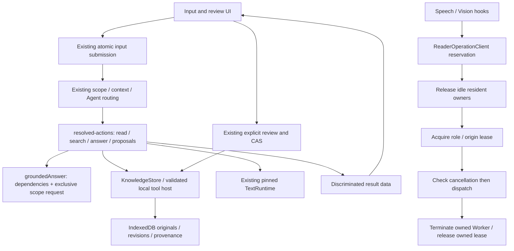

# Mobile Local Brain 0.1.0 — 実機検証用PWA

**完成判定ではありません。** GPUが取得できない検証環境のため、Bonsai 2の実生成とiPhoneオフライン受入は未確認です。ユーザーの追加指示によりGate 0未合格のまま本体構築を進めています。固定回答・クラウド推論は実装していません。

| 対象 | 結果 |
|---|---|
| コンテナのコア・資産・出典・セキュリティ自動試験 | 30件PASS。ログ `docs/container-tests.txt` |
| JavaScript構文・DOM ID・モデルpin・配信資産hash | PASS |
| 内部ブラウザプレビュー | 未実施：previewのbwrapがprocをmountできず起動失敗 |
| 公開WebMLデモの4B→2Bロード | 環境FAIL：No WebGPU adapter was returned |
| このビルドの実IndexedDB/OPFS/SW診断 | 試験コード実装済み、実ブラウザ実行は未確認 |
| このビルドの実Bonsai生成・停止 | 未実施 |
| 多言語50問の実生成 | fixture/実行コードあり、未実施 |
| iPhoneホーム画面PWA・全機能オフライン冷起動 | 未実施 |
| 推論性能・日本語/他言語の生成品質 | 未測定・未検証 |

## 初回準備

1. トップレベルHTTPSで開く。iPhoneはSafariの共有→ホーム画面に追加し、そのPWA内で以下を行う。タブとPWAの保存共有を仮定しない。
2. 管理→保存・検索テスト。初回SWが未制御なら一度再読込し、再度診断する。
3. 管理→WebGPU診断。adapter不在ならモデル対応の合格とはできない。メモ・検索・バックアップはモデルなしで使える。
4. 更新・初回準備用の通信をONにし、4Bを選んで「資産を取得・検査」。PTQ1_0重み949,549,920Bと推論コード2,208,435Bを取得。4Bが実行できなければ2B（429,183,456B）を選んで同じ手順。mmprojは使わずテキスト専用。
5. SHA-256検査完了後、通信トグルをOFF。「ローカルからロード」を実行。生成・停止を試験する。準備だけでAI対応済み・完全オフライン準備完了とは表示しない。
6. 手元ファイル導入も可能。manifestのURLからモデルGGUFとruntime.jsを取得し、指定のファイル名（またはsha256名）で選択する。全内容hashが一致しないと拒否する。

## 使い方と多言語

メモを作成し、タイトル・本文・別名を入力すると自動保存。編集ごとに新しい版を保持する。`[[メモのタイトル]]`または`[[note:ID]]`で明示リンク。同名は自動統合しない。TXT/MDはUTF-8・1件10MBまで。Markdown/HTMLは文字列表示し、外部画像・scriptを実行しない。

質問画面のSearchはモデルなしで文字N-gram索引を検索する。意味検索・Embeddingではない。回答ではBonsaiが検索語を作り、許可したsearch_notes/read_note経路で少数の原文範囲を選び、モデルへ渡す。生成は実モデルのみ。JSON・出典ID・引用一致の検査失敗は失敗表示し、原出力を確認できる。機械的な引用一致は解釈の正しさを保証しない。

入力言語は限定しない。日本語、英語、中国語、韓国語、混合言語を検索テスト。回答は指定言語または質問言語で返すプロンプト。公称対応言語と本アプリの実測品質は区別する。50問は各言語10問の検索→読取→新規生成→派生保存→書出しを実モデルで実施する診断。単純なコード読取課題であり、一般的な言語能力や複雑なツール操作を網羅しない。言語の自然さは人手評価が必要。

「この回答を新しいメモに保存」で生成済み本文を再生成せずプレビューに渡す。日本語/英語/中国語/韓国語の一部の自然言語保存命令も認識する。自由な全表現を保証しない。承認後だけ新規派生メモを作る。既存メモの上書き・削除をモデルに許可しない。撤回・訂正で根拠が古くなった派生メモは新規検索から除外する。出典はID・版・UTF-16開始/終了・原文引用を保持。

長文は2048token予算の範囲内の抜粋を渡す。選択ノート全体が入らなければ部分要約と明示。全文の階層要約・高度な意味検索は未実装。

## オフライン・保存・更新

正本と全版はIndexedDB。再構築可能なN-gram倒立索引はメモリ内。起動後に原文からオフライン再構築する。モデルとruntimeはOPFS、immutable SHA-256名。runtimeのtokenizer/config/chat templateはGGUFメタデータから抽出する。追加tokenizerの外部取得経路は使わない。

初回SWは全アプリ資産を取得し各hashを検査。使用画面に関係なく全画面/Worker/診断fixtureを保存。通常の同一originキャッシュ欠落は503で停止し、外部取得で補完しない。アプリ起動でモデルを取得しない。推論Workerはglobal fetchを拒否し、ローカルGGUFのHEAD/RangeをOPFSから返す専用fetchだけをruntimeへ渡す。初回モデル準備だけ別に保持したnative fetchでmanifestの固定URLを取得。

更新通信は起動ごとにOFF。ONでも通常推論の通信は許可しない。SWの更新は「アプリ更新を確認」でのみ明示実行。ブラウザ自身のSW管理通信・Sitesホストのアクセス管理は別系統で、アプリが制御すると主張しない。新ビルドはhash別のcacheに保存し、旧cacheは自動削除しない。モデル取得は全hash一致後だけready metadataを確定。異なるhashの旧資産は保持する。manifest変更を伴うモデル更新・旧版へのロールバックUIは今回未実装。

バックアップはモデルを含まないJSON .brainpack（schema 1、SHA-256）。原文・全版・状態・別名・生成出典を保存。復元は全検査後に1トランザクション、未登録IDのみ追加。同一IDの差分は上書きせず競合表示。端末側の撤回を旧バックアップで復活させない。競合解決UIは未実装。暗号化されていないため手元で保管先を選ぶ。

## 再現試験

- `npm test`：Node組込runner、外部依存なし。実DB/GPU試験ではない。
- `npm run check`：構文、DOM ID、モデルpin、配信資産hash生成。
- 管理→保存・検索テスト：専用使い捨てDB/OPFSを使う実ブラウザ診断。利用者のメモを消さない。
- 管理→実モデル生成テスト：その場の新しいUUID由来コードを根拠メモに入れ、Bonsaiが読めるかを検査。模擬モデル・固定回答は使わない。
- 管理→多言語の実生成50問：各言語10問。全50問を分母に記録し、失敗を除外しない。これは生成停止・人手品質評価とは別。
- 管理→冷起動診断を予約：正本の版/状態を保存。通信遮断・PWA終了・再起動後に照合し、モデルを再ロードして新しい実生成試験をする。予約だけでPASSにしない。ブラウザ再読込とOSによるPWA終了は自動判別できない。
- 機内モード+Wi-Fi OFF後に新しいメモ/TXT/MDを作成し、検索・回答・要約・派生保存・出典遷移・書出し・別の空データ領域への復元を試す。PWA終了再起動3回、端末再起動1回。AC-26/31〜36の詳細は添付仕様を参照。試験用以外の保存領域を消去しない。
- 結果は端末の管理画面からJSONへ書き出す。UA、standalone/online状態、入力tokens、所要時間を残す。onlineフラグだけで通信監査の代わりにしない。通信監査・GPU停止/device lost・更新失敗注入・容量不足試験は別途未実施。

## 配信とソース

buildless HTML/CSS/ESM。`dist/`を静的HTTPS配信すればよい。`.openai/hosting.json`はSites用。GitHub Pagesへ移す場合も相対パスを維持し、SW scopeとMIMEを実サーバーで検証する。内部プレビューの起動障害はソースの合格証拠に置き換えていない。

app.js（UI・限定操作）→core.js（版・索引・証拠・backup）→storage.js（IndexedDB）。engine.js→model-worker.js（実Bonsai runtime/OPFS）。runtimeは初回直接取得し、このソースには再配布しない。詳しくはLICENSES.txt。

GBrainは設計思想のみ参照。参照指定commit `3ed487d2b72f1c1950f7f722cd5241e4ec537e83`。今回GBrainコードはコピーしていない。BrainEngine責任分離、原文と派生物、版/撤回、明示リンク、証拠範囲を縮小採用。GBrain互換API・Embedding・MCP・常駐処理は作らない。

## 重要な未完了事項

Bonsaiの実生成・停止・iPhoneのWebGPU/メモリ/熱/全機能オフライン冷起動、Safari Worker対応、実ブラウザDB/SW試験、通常利用無通信監査、更新故障注入、容量不足、サイトのトップレベル認証とPWAの共存が未検証。Sites新規サイトは既定の所有者限定アクセスで配信。アプリ自身のアカウントはないが、ホスト側の認証が不要とは宣言しない。必要なら同梱distを認証不要の静的ホストへ移せる。

H: 指定端末・build・Bonsai revisionで、準備後に全通常機能が再接続なしに動く。
T: Node30件、実ブラウザ診断、実生成50問、上記冷起動手順。GPU/破損/漏えいで停止し記録。
D: 各環境で実行した項目だけPASS。未試験UNCERTAIN。必須項目に1件でも未試験があれば完成宣言しない。
C: adapter不在、非対応演算、OOM、GPU lost、資産欠落、引用不一致、再接続依存。
U: OS・Safari・GPU・熱・ストレージ消去・質問選択。数値的な合成不確かさや包含係数は未評価。

## 読み取り優先UIへの修正（2026-10-16）

対象は、自分の保存した情報をスマートフォンで素早く取り出す利用者。通信断や焦りを伴う状況でも、まず検索と原文閲覧を行える設計を目標とする。緊急用途の安全性を実証した製品ではない。
本文18px、回答20px、補足16pxを基準に変更。主要操作は48px以上、本文と主要テキストの指定色をコントラスト回帰試験。スマホは横スクロール一覧を廃止し、縦一覧→閲覧→明示編集へ変更。撤回は「メモの操作」、診断は任意の折り畳みへ移動。表示言語を簡潔にしたが、多言語入力・生成方針は変更していない。
これらはソース上の回帰確認であり、Safariでの実レイアウト、文字拡大、片手操作、焦った状態での誤操作率を検証したものではない。内部プレビューの既知の環境障害は未解決。アクセシビリティ適合・緊急用途適合の宣言はしない。

## English conversation UI（2026-10-17）

Default screen: Chat. Product labels/errors are English; note/message content is unrestricted. Instructional paragraphs, taglines and onboarding explanations were removed from the UI. Operational labels and essential states remain. Notes keep the large-text reading/editing flow. Enter sends, Shift+Enter inserts a newline, and IME composition is not submitted. Confirmed answers are stored as a local conversation history (last 100 successful turns), with collapsed source references and an explicit Save note preview. Conversation history is derived state and is not currently included in .brainpack. No fixed or simulated model answer was added.
Prepared models are loaded locally on first chat submission; no network fallback is permitted. Missing models show Set up. The last selected model is remembered. Failure to load still prevents generation. Broader browser and iPhone verification remain incomplete; static/Node checks do not establish usable model inference or rendered visual quality.

## Minimal controls（2026-10-17）

The application label is Local. The primary mobile navigation has two destinations: Chat and Notes. Settings is a header action. Chat's composer shows a single Send action, or Stop while generating. The mode and attachment controls are not exposed. Summarize/History/Withdraw are inside More. Backup/diagnostics/model maintenance remain available behind disclosure. Model loading is still local and no readiness is fabricated. Buttons are at least 56 CSS pixels high; Send is 60. These are source checks, not measured real-device usability. Legacy offline clients may need the explicit Check for updates action and a full close/reopen to receive this build. Existing user-authored multilingual content is preserved.

# Architecture implementation notes archived from ARCHITECTURE.md

These dated notes record implementation decisions that were previously interleaved with the current architecture. For current behavior, use the canonical contracts linked from ARCHITECTURE.md; for verification evidence, search TEST-RESULTS.txt by feature/build/test ID.

## Mixed stored-file discovery — 2026-10-27

Stored search alternates independently ranked metadata and text hits within the shared result budget, deduplicating by note ID and preferring a validated passage when both lists identify the same file. File-only hits remain navigation metadata, not citable content; the bound and source admission remain unchanged. This prevents many filename-only matches from excluding every text match, but is not exhaustive retrieval or proof of semantic relevance.

## Stored-file discovery ranking — 2026-10-27

Stored-file discovery reserves the best ranked passage for each matching note before filling spare result slots with other passages. This prevents a long file from occupying the entire bounded result set before the UI groups by file. Grounded passage search and source offsets are unchanged; the existing 12-result cap and relevance ranking still limit discovery.


## Saved-note provenance — 2026-10-27

NoteView now retains canonical kind and detached whitelisted source references. The optional NoteSources disclosure reads the canonical graph through note-provenance.ts, keeping historical availability separate from current grounding admission. Existing citation preview and current-file navigation retain their separate revision semantics. Source statuses are derived local presentation, never persisted authority or automatic regeneration. PreviewSelection owns superseded reads. See [saved-note provenance](NOTE-PROVENANCE.md).

## Literal versus semantic correction — 2026-10-27

correction-request.ts shares named-subject admission and exact quoted operand parsing. Ordinary literal replacements use the existing validated text.replace proposal before acquisition; semantic work acquires the selected engine only when needed. Quoted content remains data at routing boundaries, not a saved-file/history/question command. Both paths share canonical target discovery and review/Save/CAS/history. Managed settings, schedules and custom tool sources retain their typed adapters. See [correction contract](CORRECTION-CONTRACT.md).

## Saved-file planning boundary — 2026-10-27

Explicit saved-content work excludes unrelated dialogue/current-file selectors before context preparation and planning. Existing read-only discovery can terminate in a reviewed edit only when its exact target is present in successful built-in results and a fresh canonical ID/version/path read agrees. The model still proposes the transformation; full review/approval/CAS/history own all knowledge writes. Navigation-only file metadata remains distinct from source content. See [Saved-file planning](SAVED-FILE-PLANNING.md).

## Recorded conversation outcomes — 2026-10-27

Archived original snippets now carry separately projected application outcomes. A bounded earlier-operation information scope reads retained requests/statuses directly, omitting lossy summaries and excluding inquiry retries. It owns no write or network capability and does not inspect knowledge files. A dialogue.read receipt records the bounded snapshot before acquisition; local generation reports historical outcomes rather than inferring success from requests. Long outcomes remain stored but are omitted from model context as unknown. Native single-original copy/rewrite remains unchanged. See [Recorded conversation outcomes](OPERATION-OUTCOMES.md) for limits and provenance.

## Explicit saved-note summaries — 2026-10-27

A bounded summary command with a concrete saved-Memory descriptor selects summary/knowledge before model action selection. Retrieval uses the descriptor; grounded generation still sees the full request. No old dialogue compression or custom-tool planning is needed for that scope. Canonical source validation precedes acquisition; missing evidence fails without a model run. Current input, deictic/vague/earlier-dialogue or compound actions retain existing routes. Generated text still passes citation validation; saving is the existing exact-copy review and explicit new-note commit. No permissions or canonical migrations change.

## Unsent composer boundary — 2026-10-27

composer-draft.ts isolates exact unsent text in tab-local sessionStorage. It restores editable input only; canonical notes, shared dialogue and backups are unchanged. A synchronous functional setter preserves the newest local text during consumption/recovery and exposes denied reads/writes without throwing away input. Failed writes and pending attachments participate in ordinary reload protection. No files or source receipts are fabricated; closed-session/OS recovery is not claimed. See [Composer draft contract](COMPOSER-DRAFT.md).

## Shared search folding — 2026-10-27

Canonical core exports normalizeSearchText (NFKC, fixed Japanese case folding, whitespace collapse/trim). Indexed search retains its existing alias and scoring. Metadata discovery and the Memory browser reuse the same normalizer instead of maintaining separate width-sensitive rules. The browser applies the normalized query to visibility, search labels and scope selection; an empty folded query stays normal browsing. Comparison strings are never saved or used as citation offsets; paths, bodies, versions and source validation remain literal.

## Direct device Performance runs — 2026-10-27

startDeviceTestSuite runs Performance immediately in both browser tabs and installed PWAs. Only Quick on the Home Screen arms the existing one-shot restart continuation. Legacy Performance markers remain readable and complete once; no marker migration or user-data reset is required. Both paths use the existing selected-model test, local prepared assets, stop controls and bounded report. Skipped runs retain their mode and omit empty timing rows. Performance is one bounded sample, not offline cold-restart, thermal or quality certification.

## Immediate-answer source questions — 2026-10-27

When no file is selected and no current attachment/reading competes, a deictic question about this/that note can bind the sole eligible note/revision cited by the immediate current answer. Multiple excerpts of the same note/version deduplicate; multiple sources/versions, quoted references, explicit other actions/comparisons and earlier-dialogue questions retain existing routing. Intervening unrelated requests/capture outcomes also refuse this binding. An exact retry after the same question's bounded failed/stopped/not-prepared outcome may still use that answer. The shared earlier-dialogue recognizer now includes 前の会話. This remains bounded English/Japanese scope selection, not general pronoun resolution.

sourceFile is transient admission metadata, not a model-produced target or a persisted input-file selection. It feeds the existing file read/grounding boundary; the canonical pinned version must still be active/current and eligible. Missing/changed/withdrawn source fails before acquisition instead of silently selecting another revision. The existing opened-file selection keeps precedence. No new write permission, storage migration or tool is introduced. File coverage now says referenced rather than explicitly opened because citation-bound questions do not open a UI file. A valid binding omits irrelevant history compaction/general planning; generation and source validation remain real local runtime operations.

## Capture cancellation acknowledgement — 2026-10-27

CAPTURE_REVIEW_STATUS is shared by admission and cancellation. cancelCaptureReview is a pure dialogue transition: only the exact turn still in Review before saving becomes Save cancelled; original user/answer/source references and other turns remain, and newer settled outcomes are no-ops. Creation-sheet exits commit that transition through the existing queued CAS writer before closing. Dirty Keep editing/dismissal never requests cancellation. Explicit discard clears form fields only after cancellation succeeds; failures retain the form and expose an error. A local lock prevents repeated exits during acknowledgement. Successful note creation skips this cancellation path, including the existing note-saved/conversation-acknowledgement-failed outcome. File/Folder switching abandons the original capture only after the existing dirty-form confirmation. Ordinary manual creation and generated-answer copy have no capture turn to cancel.

This does not migrate historical stale labels or add durable capture-draft recovery after OS termination. Existing note/revision/source and correction-review contracts remain unchanged.

## Literal new-note review admission — 2026-10-27

A standalone supplied statement followed by a separate Japanese メモして/記録して command can open the existing capture review with exact body bytes. This recognizes a bounded explicit command form, not general Japanese intent. Attachment/reading scopes, dialogue/file references, question marks and recognized transformations/actions keep the planner path. Existing literal commands retain precedence. A pinned file does not turn an admitted new capture into an edit: capture has no file target and the canonical review/save transaction remains the only writer. No model acquisition, history counting/compaction, retrieval, generation or automatic persistence is needed for this literal review. Unsupported/ambiguous wording remains model-routed. The change does not alter generated-answer Save, correction approval/CAS/history or model safety policy.

## Current-answer formatting boundary — 2026-10-27

An explicit rewrite/format request about the current answer binds that exact prior assistant turn before planner/history compaction. Quoted target phrases and mixed tool/write/file commands remain outside this shortcut. A semantic read/rewrite now inherits the selected original's existing source IDs, versions and ranges instead of dropping them when plain generation returns no sources. These references establish provenance, not semantic entailment.

The read-only text inspector can select text.format_lines with a closed checklist/bullets/numbered enum. Host code formats existing nonempty lines; the model does not compose the resulting items. The operation has no network or storage ports, caps input/output at 30,000 characters and 1,000 lines, refuses code fences, nested lists and pipe tables, and preserves checked boxes and nonsequential numbers such as years. It does not perform semantic extraction, table construction or summarization. Receipts identify the exact original turn. Reviewed ordinary-note corrections may use the same operation through the existing approval/CAS/history/Undo and backup validator; no automatic overwrite is added.

## Pending correction preflight — 2026-10-27

The edit branch checks the canonical pending-review slot before Text acquisition/proposal generation. An occupied slot refreshes the review surface and returns a host-owned needsInput outcome while preserving both the existing review and new request draft. Malformed records remain inert and block replacement until explicitly handled. Staging and approval retain their complete transactional validation for cross-tab races. Read/chat routes are unaffected; classification of unresolved intents may still need a model. See PENDING-REVIEWS.md.

## Opened-file correction commands and evidence admission — 2026-10-27

A bounded single imperative correction in English/Japanese can bind the already opened file before general planning. This selects only edit/file, not replacement bytes. Attachments, explicit dialogue references, named/other/plural file targets, compound commands and unsupported wording retain the existing routes. The exact pinned original is read before Text acquisition. Correction inference receives the original and human instruction without unrelated history; local names/places/times/numbers are requested as the smallest exact text.replace span. Whole-note reorganization/translation retains the separate rewrite path. All proposals retain full Before/After, pending-review persistence, explicit approval, CAS, history and Undo. No general multilingual intent or semantic-correctness guarantee follows from these bounded rules or a successful model sample.

Initially resolved file answers/summaries similarly defer acquisition to the existing groundedAnswer callback after canonical eligibility/source checks. Missing, withdrawn or empty files fail without load, compaction or releasing an unrelated resident. Valid sources still use the same local-only runtime/lease manager and generation/source revalidation. No new runtime, permission, storage migration or network fallback is introduced.

## Reviewed answer source selection — 2026-10-27

Save note starts from its already pinned answer. DialogueCopySource owns only optional, bounded source browsing (12 original previews per page, NFKC search); dialogue-copy.ts remains the read-only selector and commit-time original/reference validator. Internal message numbers are no longer a second mutable form field. Same-source selection preserves manual edits; choosing another source after edits uses the existing discard review. Stored original bytes, revision refs, approval and compare-and-swap contracts are unchanged. No generation occurs during selection or saving.

## Bound file questions do not prepare dialogue context — 2026-10-27

When the initial resolved answer/summary already targets a file, Send skips dialogue counting/compaction. The grounding layer validates that pinned revision and already excludes unrelated conversation for file evidence, so preparing global dialogue first served no answering purpose. It could nevertheless generate/persist an unrelated compaction. Explicit saved-Memory, attachment and original-message paths retain their existing context policy; unresolved requests still prepare history when planning needs it. File source validation, acquisition ownership, token limits, generation/citation checks, source-change refusal and reviewed Save are unchanged. Initially bound file answer/summary now validates original eligibility before acquiring the selected model through the existing manager. Unresolved planner routes still acquire a model to classify intent. No claim is made that every source-preflight latency is eliminated.

## Selected dialogue originals use native messages — 2026-10-27

After the application resolves one exact prior message for recall/rewrite, its transient context uses `selectedOriginal: {speaker, text}`. The generation boundary emits that exact text under its native user/assistant message role and the latest instruction separately. Canonical turn ID/index, speaker and original range remain in the existing read/inspection receipts; they are no longer encoded as archive JSON for this single-source generation. This avoids giving the model administrative labels to reproduce. The fixed system still treats earlier text as untrusted context and grants no tool/write/network authority; selected-original output asks for no added speaker labels unless requested. No prefix stripping or original-text rewriting is performed, so literal labels remain available for exact quotation.

General multi-turn history, archive retrieval/compaction, canonical source selection, literal split/replace tools, output budgeting/continuation, cancellation and reviewed Save retain their existing paths. The new field is transient application context, not a persisted dialogue/schema migration or a user-supplied role-control setting. Controlled tests verify native speaker roles/exact bytes, exclusion of unrelated archive metadata and retained canonical target receipts. Runtime/model output quality remains evidence-scoped.

## Retained dialogue outcome projection — 2026-10-27

`dialogueTurnStatus` is the shared UI/history projection for the fixed interrupted-request marker. A nonempty completed answer suppresses a stale marker retained by older builds, without rewriting stored turns, answers, source refs, revisions or activity. Genuine errors such as Stopped remain visible even beside answer text. Blank/missing answers remain unfinished. The UI can additionally suppress the placeholder for the exact currently executing turn; another running request must not hide historical unfinished turns. The history/model boundary uses the completed-answer rule without any active execution exemption. Input submission and completion share the marker constant; canonical note storage and dialogue schema are unchanged.

## Bounded citation protocol repair — 2026-10-27

Grounded answers can make one protocol retry for a citation mismatch when the existing single-source exact-quote recovery does not apply. The retry keeps the original question, evidence and output budget; a fixed application instruction requests verbatim quotes from the matching source labels. It does not splice guessed quotations into output or silently remove invalid citations. Sources are revalidated against current originals before retry, actual tokenizer limits and cancellation remain enforced, and the final response must pass the unchanged parser and current-revision validation. A second mismatch fails; no retry loop or automatic model change occurs. Successful repairs are identified as `recovery: citation-retry` in the existing operation receipt. Syntax repair and citation repair share one retry branch; single-source exact-quote recovery retains its prior scope. This verifies byte provenance, not general semantic entailment or model answer quality.

See [the current review and migration target](ARCHITECTURE-REVIEW.md) for remaining structural gaps.

## Retrieval-bound evidence and deferred acquisition — 2026-10-27

A question explicitly naming saved Memory, or a literal answer:/summarize: command, starts a fresh stored-source scope. Failed retrieval cannot borrow references from unrelated dialogue. When retrieval returns passages, historical excerpts may extend only the same retrieved note/revision pairs. Deictic follow-ups retain the existing validated-source path; no historical record is deleted or rewritten. Stored-knowledge generation with no eligible evidence (and no checked calculation) stops before token counting, compaction or generation. This validates evidence scope/bytes, not universal semantic relevance of search hits or model claims.

For already explicit Memory answer/summary routes, submission defers Text acquisition to groundedAnswer through a trusted acquireModel callback. Retrieval and source validation run first; only a nonempty admitted source set invokes the existing model execution manager, with its idle-owner release, lease, local-runtime verification, selected-model checks and cancellation rules. General planner routes still need a model to select an action. Source versions are checked again after generation/compaction. No network fallback, new preparation permission or knowledge write authority is introduced.

## Explicit current-answer rewrites — 2026-10-27

A bounded, single read-only rewrite that explicitly names the current assistant answer (for example, Japanese 今の回答を日本語で短くまとめて or English Summarize your last answer) binds target=current before Decision/Text planning. The canonical dialogue resolver selects the exact retained answer ID and assistant speaker, including legacy records without a persisted currentResult pointer. Missing targets fail rather than falling through to Memory. This uses the same explicit-source principle as current-file/current-attachment routing; it does not infer a target from bare it/that.

The application verifies/loads the selected local Text model when needed, without compacting unrelated history for this already bound target. Existing read-only text inspection and conversation generation perform the actual requested rewrite from the selected original. Opened-file metadata or stored-note excerpts cannot become replacement input. Original turns and knowledge remain unchanged; writes, mixed source commands and unsupported phrasing retain their existing approval/planner routes. This is a scoped routing correction, not general semantic source validation or a fixed translated answer.

## Dialogue provenance and rejected history selectors — 2026-10-27

The model-facing history projection now retains at most12 distinct source ID/
revision pairs per turn. It does not copy reference quotes, paths or arbitrary
reference fields into dialogue. Planner and reply history label these identities
as navigation/provenance metadata, never source contents. Canonical dialogue,
originals, backups and source validation contracts are unchanged. Factual
follow-ups about saved content still require the grounded answer path; provenance
metadata alone cannot authorize a citation, write, tool or network operation.

The agent coordinator may replan once per submitted turn after the fixed
validator category `history target` rejects a missing history selector. The
rejected plan executes nothing and keeps its failed receipt. A fixed host-owned
hint asks the model to re-evaluate; raw diagnostic/model output is not fed back
as an instruction and no original index or speaker is filled in by the host.
The new plan goes through the complete existing validator and scope checks.
Other planner protocol errors, runtime failures, Stop and receipt-storage failures are
terminal. Repeated history-selector rejection is terminal, and the tool-call
budget does not increase. This is bounded protocol recovery, not a guarantee of
correct semantic routing or factual answers from any model.

## User device performance samples — 2026-10-26

Developer retains one Run tests action. Test options selects Quick (default) or
Performance. Quick validates exact structured READY; Performance runs one fixed
prose-128-v1 sample with at most128 output tokens. Home Screen continuation
persists the finite test mode; unknown persisted modes are rejected, and old
markers default to Quick. The UI reports actual Load time, available TTFT,
end-to-end generation speed, token counts and runtime memory counters. It hides
old success/metrics and disables copying the previous report during a new run.

The bounded report includes workload, configured engine/backend, registered
quantization metadata, model/runtime revisions, input/output tokens and load
state. Known CPU thread/prompt/cache counters are accepted; no physical-core
or GPU-selection claim follows from configuration or prerequisites. Copying
projects only allowed metadata and never includes generated reply text.
One timing sample is not sustained performance, thermal or answer-quality proof.


## One-button device test — 2026-10-26

Settings > Developer now has one Run tests start action. The UI-independent
`device-test-suite.ts` collects a bounded baseline once. In an installed Home
Screen app it saves the report before arming the existing one-shot continuation;
selected Text generation runs only after relaunch. The selected ID is bound in
the marker and the existing claim-before-execution crash guard prevents repeats.
The user performs Airplane Mode, app close and Home Screen launch. The browser
cannot verify those OS actions; existing report warnings remain authoritative.

A browser-tab run checks the prepared selected Text model immediately, then saves
one report without arming a separate Home Screen storage context. No model files
or runtime assets are acquired by these tests; unprepared or blocked models are
not-run. The test's own loaded Text model is unloaded afterward. Model replies
are discarded, not retained in diagnostics or knowledge. One Run is the explicit
consent for the short selected-model check; the old separate generation button
and off-by-default after-restart checkbox have been removed from Developer.

The primary action becomes Cancel test while awaiting a restart. Copy report
remains a separate output action; Stop remains available during model execution.
The local report stays bounded and privacy-preserving. Existing schema-1 markers,
including legacy modelTestRequested=false, still use their original continuation
semantics. No changes to knowledge storage, model defaults or network settings.

## Execution outcomes and model acquisition — 2026-10-26

`execution-result.ts` separates host-owned outcomes from transient lifecycle:
answered, imported, displayed, awaitingApproval, needsPreparation, needsInput,
partial, cancelled and failed. Submission functions return an outcome on every
normal path. Preparation/input requirements produce blocked lifecycle state;
an unread original produces partial rather than an implied successful answer.
Existing dialogue status strings and schemas are unchanged. Correction reviews are durable as described in PENDING-REVIEWS.md. Capture and
new-task review handoffs still have separate recovery work.

`model-execution.ts` centralizes acquisition policy for Text, Decision and
release before reader operations. Existing engine clients still own Workers,
pinned identities and inference leases. The manager is bound to runtime
adapters; it does not introduce another Worker pool, global lock or model cache.
Automatic Text/Decision acquisition verifies local runtime assets only. A missing
Text selection/file returns a typed requirement before releasing another
resident. A loaded Text route is reused and pinned. A completed Load must report the
selected Text resident or a positive Decision loaded receipt before success.
Release/verification/Load
boundaries check cancellation; a busy resident is never forcibly interrupted.
Explicit Text Load may prepare runtime assets only with the caller's existing
download permission; it does not acquire model weights. Asset preparation stays
an explicit user operation. Runtime verification errors remain errors unless
the host has a typed preparation requirement; model error text cannot declare
new capabilities or change outcomes by resembling a UI label.

Normal Send, generated capture and ordinary conversation all use this policy
when grounded answering needs a model, including routes that previously reached the answer
helper directly. `scheduled-answer.ts` moves scheduled answering out of the
screen and shares acquisition plus grounded answering. It receives only the
read-only all/search storage contract, selects a knowledge scope and has no
planner/tool registry, approval or knowledge-write port. Scheduled capture is
refused before acquisition. Scheduling still requires foreground/resume support;
this change does not create suspended/closed-PWA execution.

Speech/Vision retain their bounded operation lifecycle and existing lease-owned
cleanup; this increment centralizes their release-before-entry callback, not
model-residency duration. It adds no automatic startup preload, parallel model
residency, performance claim or arbitrary engine/model support. The obsolete
Text-only preparation helper was replaced; its ordering tests now target the
shared manager. Next: durable approval recovery and validated configuration
activation snapshots, then command-based storage and incremental indexing.

## Send application boundary — 2026-10-26

The accepted UI and canonical schemas remain unchanged. Normal Send now enters
`submission-controller.ts` and `submission-workflow.ts`; the screen no longer
contains the submission, routing, agent dispatch and answer pipeline.

```text
Prototype: interaction guards + view/storage/runtime adapters
  -> SubmissionController: attempt identity, AbortSignal, ownership, transient state
  -> executeSubmission: atomic input -> current scope/context -> route -> action
       -> input-submission / turn-router / agent-coordinator / resolved-actions
       -> existing canonical storage transactions and pinned inference adapters
  -> typed view ports: consume/restore composer, adopt receipt, show result/review
  -> existing explicit approval -> existing CAS/history transaction
```

The controller exposes idle, running, stopping, completed, awaitingApproval,
cancelled and failed phases, with separate saving/reading/planning/generating
stage, progress and per-attachment display data. It has no React, storage,
model, tool or network dependency. One active owner is retained until the work
settles, even after Stop; a second Send cannot overlap a cancelled operation's
pending commit. Obsolete progress callbacks cannot update a later attempt.
The outcome contract above now distinguishes preparation/input requirements and
partial results from answers; completed lifecycle alone still does not certify
model compatibility, source completeness or the user's entire objective.

The workflow receives the selected model/settings, existing runtime interfaces,
tool packages/registry, storage functions and bounded diagnostics store through
explicit services. It has no React imports, JSX, browser-global storage access,
UI setter or navigation implementation. View ports receive review data and
cannot grant additional authority. The retained use of KnowledgeStore and the
existing broad attachment view contract is an incremental seam, not a claim
that every domain/platform dependency has already been separated.

The controller owns transient lifecycle only. Durable dialogue schema 1, the
legacy interrupted-turn recovery sentinel, activity receipts, source checks,
original bytes, IDs, revisions, approval and CAS remain unchanged. The screen's
legacy sendLock is a synchronous compatibility gate for other screen actions
and explicit dialogue recovery, mirrored from controller ownership during Send;
it no longer owns Send cancellation or attempt identity. Future durable lifecycle
changes require an explicit backward-compatible design rather than rewriting
stored status strings during this refactor.

Stop during input commit cannot roll back an acknowledged transaction. The
workflow adopts its receipt and clears the submitted composer before checking
cancellation; recovery restores only pinned references into an empty composer.
Correction, Schedule, capture and tool-draft routes end at awaitingApproval;
existing review callbacks perform no automatic knowledge overwrite. Scheduled
work retains its separate read-only execution path in this increment.

Focused coverage: `npm run test:submission`. See the implementation checklist
in [the plan](superpowers/plans/2026-10-26-submission-boundary.md) and dated
[verification results](TEST-RESULTS.txt). This boundary does not certify new
model support, physical-device performance or suspended-PWA scheduling.

## Public media follow-up — 2026-10-26

The bounded current-input question recognizer includes literal English/Japanese PDF nouns; a self-contained PDF question uses the submitted original IDs/revisions rather than another model-selected dialogue target. Mixed actions, earlier-dialogue requests and absent inputs retain their existing refusal/planning behavior.

When one current reading/one revision receives a malformed answer shape, grounded answering may use the existing bounded verbatim generation route. This is another real model call under the answer-only schema, not extraction of a guessed answer from malformed JSON. Only a contiguous substring of current source evidence can become an answer, with host-owned source pins and a final original/revision eligibility check. Attachment citation mismatches, invented text, Stop and budget failures remain refusals. The receipt identifies `verbatim-source` recovery when used.

Sampled-video construction projects only `model`, `revision` and `runtime` from frame replies. A real frame reply's `scope: single-image` must never overwrite the host-owned video schema, sampled-video scope, prompt, plan or ranges. Each sampled frame and the audio transcript remain separate coverage within the resulting observation. Public PC sidebar execution is recorded in SITES-DEPLOYMENT.md; it is not a general media-quality or physical-device claim.

## Vision preparation and answering — 2026-10-26

`vision-assets-worker.ts` is a small core-shell worker for local file verification,
cache repair and readiness. It contains no inference engine. `vision-worker.ts`
is the separately prepared WebGPU inference worker. `ReaderOperationClient`
selects the asset factory for status/prepare, disposes it before switching to
inference, and retains its existing lease/cancellation ownership. A preparation
request may wait for the invisible initial status operation; Stop invalidates
that continuation. Local file import never acquires the inference runtime or
permits network access. The UI distinguishes verified files from a prepared
runtime and retains preparation errors beside the model.

Initial preparation probes the selected builtin or registered custom LFM2-VL
package through the same asset worker. A custom package must already be imported;
it never acquires builtin weights as a substitute. Its label and activity identity
follow the selected package. Actual custom-model inference acceptance is separate.

For a self-contained question about one current image, a bounded output-format
suffix does not require another planner pass. `answerCurrentVisionInput` can
return the already generated Vision result when its original prompt matches the
current question exactly. It accepts only an unchanged revision-1 single-image
observation, validates its active original/source links, rechecks the snapshot
before delivery, and records the actual Vision model identity. It has no model
generation, write, delete or network port. The existing explicit Save review
owns persistence. Multiple inputs, different questions, transformations, dialogue
dependence and additional response preferences retain the normal answer path.

Build `9873e37317e6a138` passed one actual offline Windows Chrome image-answer,
source-preview, exact-save and cold-restart/read workflow. This is PC evidence
for that scoped route; video, broad recognition accuracy and physical-device
acceptance remain separate. See the dated harness acceptance report.

## Harness boundary update — 2026-10-25

The current source adds the bounded execution seams below. Acceptance and exact
build evidence are tracked in [the harness acceptance record](HARNESS-ACCEPTANCE-2026-10-25.md).



`resolved-actions.ts` receives a pinned engine, canonical-store adapter, typed
registry, snapshot port, cancellation check and the existing activity tracer.
It returns search results, file-open/continue decisions, exact answer text and
sources, schedule clarification/proposals and correction proposals. It has no
React imports, setters, sheet names or edit-approval/commit API. Input/dialogue
commit and review presentation still belong to the UI transaction; extraction
does not merge their different commit scopes. Foreground schedules continue to
call the typed answer boundary without inheriting dialogue Agent privileges.

Speech and Vision share a client lifecycle. The request is reserved before
awaiting resident-owner release, then acquires its operation lease and checks
cancellation before dispatch. Busy resident owners are refused by the existing
release policy. Stop rejects promptly while retaining the reservation until any
late-acquired lease is released. Success/error delivery waits for owned cleanup;
status/preparation do not acquire inference leases or release resident models.
This describes application ownership, not GPU-driver reclamation or model fit.

The four reader-save methods retain their public typed builders and provenance
validators, while `KnowledgeStore.saveReading` shares their existing notes/runs
transaction sequence. The transaction helper still adds settings scope and
checks folder namespaces. Atomic attachment submission and reviewed note-save
then dialogue-acknowledgement remain separate existing contracts.

The worker network reader accepts the current Connection `schemaVersion: 1`
and the legacy unversioned record; unsupported versions/keys fail closed. This
fixes explicit runtime preparation being refused even after Online was saved.
It adds no implicit download or remote inference.
