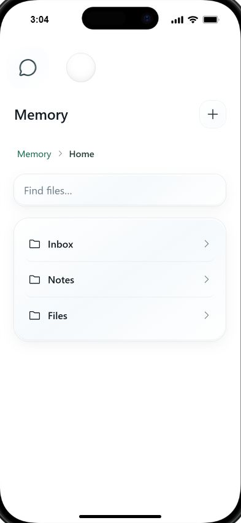
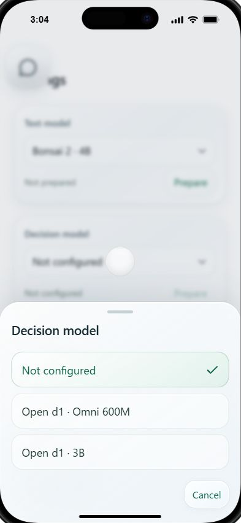

# Local verification — 2026-10-17 JST

Host: Windows PowerShell, Node 24.6.0. Working repository: babelshelf. No deployment, model download or remote inference was performed.

| Check | Observed result | Scope |
| --- | --- | --- |
| npm test | 33 passed | Baseline core/source/server tests; includes old baseline navigation checks |
| npm run check | Passed; 23 shell assets | Baseline syntax/DOM/model pins/generated asset hashes |
| npm run test:markdown | 4 passed | Formerly pending Markdown acceptance seed, now implemented |
| npm run test:prototype | 5 passed | Home/ancestor mapping, protected roots, path/depth validation |
| npm --prefix design/prototype ci | Passed; 77 packages installed | Fresh repository copy after repairing dependency lock consistency |
| npm run build:prototype | Passed | TypeScript, Vite and all 28 protected runtime hashes |
| npm --prefix design/prototype run test:sites | 4 passed | Template static packaging/Worker behavior; no hosting or deployment |
| Repository UI at 127.0.0.1:4181 | Opened and inspected | Desktop in-app browser, iPhone simulation |
| Repository UI smoke | Home shows Inbox/Notes/Files; Settings opens glass Decision sheet; console errors 0 observed | Browser simulation only |

## Reproducibility fixes

The copied package-lock initially failed npm ci because optional/transitive @emnapi entries were inconsistent. Regenerated the lock using npm install --package-lock-only, then successfully ran npm ci, build and tests in the repository copy. Package role selections and UI source did not change for this repair.

A .gitattributes policy preserves prototype text as LF and device PNGs as binary so Windows checkout line endings do not invalidate protected runtime hashes. The staged Git blobs are checked against the lock before handoff.

## Warnings and unverified gates

- Vite reports a minified UI chunk just over 500 kB. The build succeeds; code splitting is future work.
- No terminal Playwright runtime suite was run; browser smoke uses the desktop in-app browser. The included runtime fixtures are not a claim of executed tests.
- Real phone touch/IME, screen readers/enlarged text, real Bonsai/d1 inference and resource use, full offline app/device restart, scheduling/notification delivery and UI persistence integration remain unverified.
- The baseline pending-seed directory name is historical; its four current checks pass.
- PWA baseline and accepted UI remain separate. Current prototype state is in memory. Do not sum these test counts into an end-to-end MVP pass.

## Repository-copy captures

The visible device frame and keyboard are template simulations. Earlier source-preview captures are retained separately in design/README.md.
