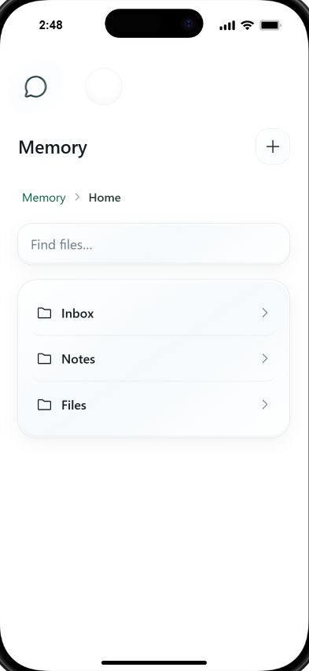
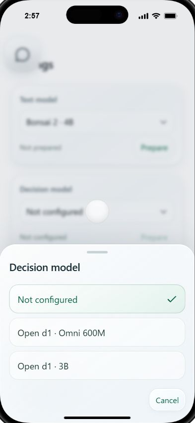

# Accepted UI captures

Captured during local design work on 2026-10-17 JST in the desktop in-app browser's iPhone simulation. These are visual references, not physical-device, persistence, model or offline acceptance results.

Memory enters Home, with user storage locations and actionable ancestor breadcrumbs. Internal storage is reached explicitly.

Text and Decision roles use app-owned glass sheets. A selected candidate is not a prepared or verified runtime. The blurred background and phone keyboard/frame are simulation behavior.

The current source in ../../design/prototype/ and ../PRODUCT-SPEC.md supersede older screenshots and chronological iterations. Existing PWA dist/ is not this UI.
